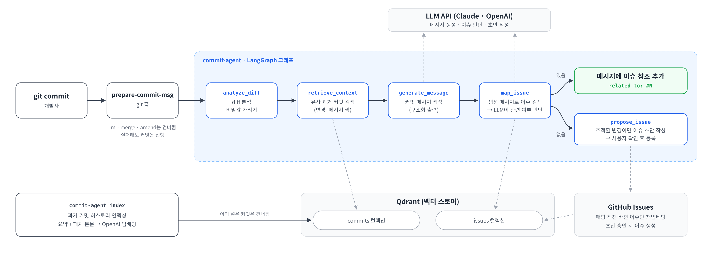

# commit-agent

> 코드 diff 분석 기반 커밋 메시지 생성 및 이슈 연동 AI 에이전트

> 아주대학교 소프트웨어학과 자기주도프로젝트 (2026-2학기)

> 개발 기간 : 2026.09 ~ 현재

## 📝 프로젝트 소개

`git commit`만 하면 스테이징된 변경을 분석해 [Conventional Commits](https://www.conventionalcommits.org/) 형식의 커밋 메시지를 작성하고, 관련 GitHub 이슈를 찾아 연결하는 CLI 도구입니다.

기존 도구(aicommits, opencommit 등)는 지금 커밋하는 diff 하나만 보고 메시지를 만듭니다. commit-agent는 **해당 저장소의 과거 커밋을 검색해 예시로 참고**하기 때문에, 같은 변경이라도 저장소마다 쓰는 타입, scope, 문체를 따릅니다.

### 1. 핵심 기능

| 기능 | 설명 |
| --- | --- |
| 커밋 메시지 생성 | 스테이징된 diff를 분석해 `type(scope): 제목` 형식으로 작성. 형식은 구조화 출력으로 강제 |
| 저장소 컨벤션 반영 (RAG) | 비슷한 과거 커밋을 "변경 + 메시지" 짝으로 검색해 예시로 제공 |
| 이슈 자동 매핑 | 생성된 메시지로 열린 이슈를 검색하고, LLM이 관련 여부를 판단해 `related to: #N` 추가 |
| 신규 이슈 제안 | 관련 이슈가 없고 추적할 만한 변경이면 이슈 초안을 작성하고, 확인을 받은 뒤 등록 |
| 브랜치 제안 | 기본 브랜치에서 커밋하면 저장소의 브랜치 규칙에 맞는 이름을 제안 |
| git 훅 연동 | `prepare-commit-msg` 훅으로 동작해 평소처럼 `git commit`만 하면 됨 |

### 2. 안전장치

| 항목 | 설명 |
| --- | --- |
| 커밋을 막지 않음 | API 오류, 토큰 만료, 네트워크 문제로 생성이 실패해도 커밋은 그대로 진행 |
| 직접 쓴 메시지 보존 | `-m`으로 쓴 메시지와 merge, squash, amend 커밋은 건드리지 않음 |
| 비밀값 가리기 | 키 파일(.pem, id_rsa 등)은 본문을 빼고, 토큰과 `API_KEY=값` 형태는 가린 뒤 무엇을 가렸는지 안내 (커밋에는 원본이 그대로 들어감) |
| diff 상한 | 파일별, 전체 줄 수와 문자 수 상한으로 한 줄짜리 대용량 파일도 안전하게 자름 |
| 외부 호출 제한 | LLM, GitHub 호출에 재시도와 대기 상한을 둬 커밋이 오래 멈추지 않음 |
| 다른 훅 보호 | 훅에 표식을 남겨, 제거할 때 다른 도구가 설치한 훅은 지우지 않음 |

## 시스템 아키텍처



## 평가

정답이 검색 대상에 섞이지 않도록 **특정 시점 이전 커밋만 인덱싱하고 이후 커밋으로 평가**했습니다. 평가 기준은 측정 전에 미리 정했습니다. 평가 코드와 결과는 [`evaluation/`](evaluation)에 있습니다.

### 이슈 매핑 (vercel/ai)

사람이 `Fixes #번호`로 직접 연결한 커밋을 정답으로 사용했습니다.

| 구분 | 결과 |
| --- | --- |
| 이슈가 연결된 커밋 40건 | 정답 이슈 38건 (95%) |
| 후보 5개 안에 정답 포함 | 39건 (97.5%) |
| 이슈가 없는 커밋 20건 | 18건을 "관련 이슈 없음"으로 판단 (90%) |

### 메시지 생성 (오픈소스 3개 저장소, 84건)

| 구분 | 타입 일치 | scope 유무 일치 | 제목 유사도 | 의미 유사도 |
| --- | --- | --- | --- | --- |
| RAG 미적용 | 75% | 57% | 0.430 | 0.657 |
| RAG 적용 | 80% | 76% | 0.492 | 0.714 |

- 미리 정한 기준 4개 중 2개 충족, 2개(타입 일치율 20%p 개선, scope 유무 일치율 80%) 미달
- 사람 메시지와 출처를 가리고 비교한 정성 평가에서는 생성 메시지가 66% 우세. 생성과 같은 모델로 판정해 자기 출력 선호 편향이 있을 수 있어 상한으로만 해석

## 기술 스택

- Agent : LangGraph, LangChain (Claude, OpenAI)
- RAG : Qdrant, OpenAI 임베딩
- Git·GitHub : GitPython, PyGithub
- CLI : typer, questionary
- 서버 : FastAPI, uvicorn (선택)
- 품질 : pytest, ruff, mypy

## 구동하는 법

### 설치

Python 3.11 이상이 필요합니다.

```bash
git clone https://github.com/HoYoung528/commit-agent.git
cd commit-agent
python -m venv .venv
source .venv/bin/activate        # Windows: .venv\Scripts\activate
pip install -e .
```

### API 키 설정

커밋 메시지를 만들 저장소의 루트에 `.env`를 두거나 환경변수로 설정합니다. 항목 설명은 [`.env.example`](.env.example)에 있습니다.

```bash
GITHUB_TOKEN=...          # 이슈 조회·생성용
ANTHROPIC_API_KEY=...     # 쓰는 LLM 제공자 쪽만 채우면 됨
OPENAI_API_KEY=...        # 임베딩용이라 항상 필요
```

> `.env`가 커밋되지 않도록 해당 저장소의 `.gitignore`에 추가하세요.

### 사용법

```bash
cd my-project                # 커밋 메시지를 만들 저장소

commit-agent init            # 저장소 설정 파일(.commit-agent.toml) 생성
commit-agent index           # 과거 커밋 인덱싱
commit-agent install         # prepare-commit-msg 훅 설치

git add .
git commit                   # 메시지가 채워진 편집기가 열림
```

| 명령 | 설명 |
| --- | --- |
| `commit-agent init` | 언어와 허용 타입을 물어 `.commit-agent.toml` 생성 (`--yes`로 기본값 사용) |
| `commit-agent index` | 과거 커밋을 벡터 스토어에 인덱싱. 이미 넣은 커밋은 건너뜀 (`--rebuild`, `--limit`) |
| `commit-agent install` | 훅 설치. 다른 훅이 있으면 덮어쓰지 않음 (`--force`) |
| `commit-agent generate` | 훅 없이 메시지만 생성해 표준 출력으로 출력 |
| `commit-agent uninstall` | commit-agent가 설치한 훅만 제거 |

### 서버로 실행하기 (선택)

기본값은 로컬 실행입니다. 위 사용법만 따르면 서버 없이 동작합니다.

팀에서 함께 쓰려면 에이전트를 서버로 띄울 수 있습니다. 그러면 **모델 API 키를 서버에서만 관리**하고, **저장소별 커밋 관례 인덱스를 공유**합니다. 한 사람이 `index`를 돌리면 같은 저장소에서 커밋하는 다른 사람은 인덱싱 없이 그 관례대로 메시지를 받습니다.

**1. 공유 벡터 스토어**

```bash
docker run -d --name qdrant -p 6333:6333 qdrant/qdrant
```

**2. 서버**

```bash
pip install -e ".[server]"
uvicorn commit_agent.server.app:app --host 0.0.0.0 --port 8000
```

서버의 `.env`:

```bash
ANTHROPIC_API_KEY=...                              # 또는 OPENAI_API_KEY
OPENAI_API_KEY=...                                 # 임베딩용
COMMIT_AGENT_VECTOR_STORE_URL=http://qdrant:6333
```

**3. 클라이언트**

모델 API 키가 필요하지 않습니다. 대신 **벡터 스토어 주소를 서버와 같은 값으로** 둡니다 — 인덱싱은 클라이언트가 하고 검색은 서버가 하므로, 다르면 서버가 빈 인덱스를 봅니다.

```bash
COMMIT_AGENT_SERVER_URL=http://서버주소:8000
COMMIT_AGENT_VECTOR_STORE_URL=http://서버주소:6333   # 서버와 같은 값
GITHUB_TOKEN=...                                    # 이슈 조회용. 본인 토큰
OPENAI_API_KEY=...                                  # index 명령의 임베딩용
```

`COMMIT_AGENT_SERVER_URL`을 비우면 로컬 실행으로 돌아갑니다. 서버가 멈췄을 때 이렇게 쓰면 됩니다.

**알아둘 점**

- **커밋 훅 안에서 네트워크를 탑니다.** 서버가 멈추면 커밋이 막히므로 안내와 함께 실패합니다. 로컬 실행에는 이 의존이 없습니다
- **전처리가 서버에서 일어납니다.** 민감정보를 가리는 일이 그 안에 있어서, diff 원문이 서버로 갑니다. 신뢰할 수 있는 서버에만 붙이세요
- **서버 모드에서 `index`는 GitHub 원격이 있는 저장소에서만 됩니다.** 저장소를 구분할 수 없으면 여러 저장소의 인덱스가 섞입니다
- **접근 제어는 없습니다.** 저장소별로 나뉘기만 하고, 다른 사람의 저장소 이름을 알면 그 인덱스를 요청할 수 있습니다. 계정 기반 인증은 구현하지 않았습니다

### 저장소 설정 (`.commit-agent.toml`)

팀원과 공유하도록 커밋하는 파일입니다. 파일이 없으면 기본값으로 동작합니다.

| 항목 | 설명 | 기본값 |
| --- | --- | --- |
| `language` | 커밋 메시지 언어 (`ko`, `en`) | `ko` |
| `types` | 허용하는 타입. 비우면 전체 허용 | 전체 |
| `scopes` | 허용하는 scope. 비우면 자유롭게 사용 | 자유 |
| `max_header_length` | 첫 줄 최대 글자 수 | 72 |
| `reference_format` | 이슈 참조 줄 형식 (`{ref}` 자리에 `#번호`) | `related to: {ref}` |
| `issue_mapping` | 관련 이슈 매핑 사용 여부 | `true` |
| `propose_issue` | 신규 이슈 제안 사용 여부 | `true` |
| `branch_suggest` | 브랜치 제안 사용 여부 | `true` |
| `issue_template` | 자동 생성 이슈 본문 틀. 비우면 언어별 기본 틀 | 기본 틀 |

## 프로젝트 구조

```
src/commit_agent/
├── cli/               # typer 명령, 훅 스크립트, 브랜치·이슈 등록 대화
├── agent/             # LangGraph 그래프와 노드, 프롬프트
├── change_analysis/   # diff 파싱, 전처리, 비밀값 가리기, 요약
├── rag/               # 커밋·이슈 인덱싱과 검색
├── git_integration/   # GitPython, PyGithub 연동
├── server/            # FastAPI 엔드포인트 (선택 설치)
└── core/              # 설정, LLM·임베딩·벡터 스토어 초기화
evaluation/            # 평가 스크립트와 결과
tests/                 # 노드 단위, 그래프, CLI·서버 통합 테스트
```

## 테스트

```bash
pip install -e ".[dev]"
pytest
```

테스트 209개, 커버리지 89%. LLM, 임베딩, GitHub만 가짜로 바꾸고 git과 벡터 스토어는 실제로 실행합니다.
